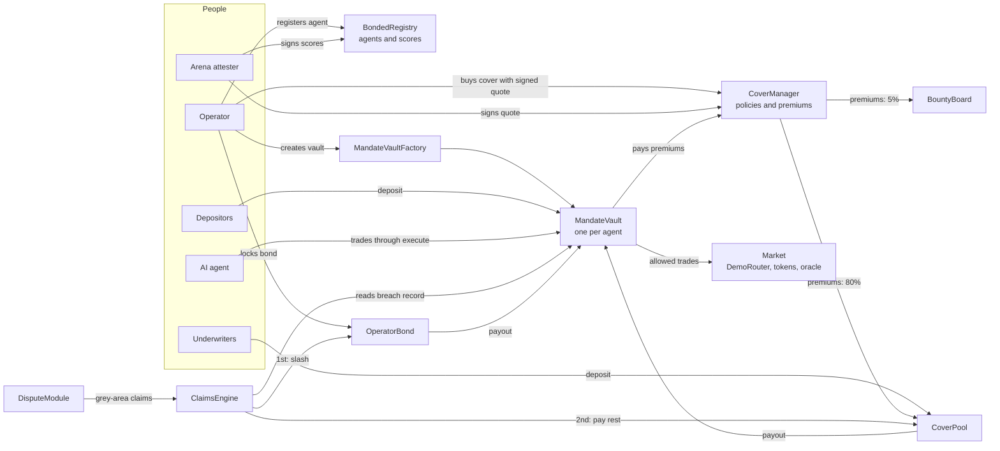

# Bonded smart contracts

These are the Solidity contracts behind Bonded. They hold AI agents' money under a set of rules (the **mandate**), sell insurance on those agents, and pay depositors automatically when an agent breaks its rules.

This page explains what each contract does, how they fit together, and where the money goes. For the reasoning behind each design choice, see the decision records linked at the end.

**Live on:** Robinhood Chain testnet and Arbitrum Sepolia. The addresses are in [`deployments/`](deployments/README.md).

## At a glance

A deployment has **14 contracts**, plus one **Mandate Vault** per agent, created as agents sign up:

- **8 protocol contracts:** Bonded itself. These are the same on testnet and mainnet.
- **6 demo-market contracts:** testnet only. Fake tokens, a price feed and a small exchange, so agents have something to trade.

| Group | Contract | In one sentence |
|---|---|---|
| Protocol | [`BondedRegistry`](src/BondedRegistry.sol) | The directory of AI agents, their owners, and their safety scores. |
| Protocol | [`MandateVaultFactory`](src/MandateVaultFactory.sol) | Creates a vault for each agent and vouches for which vaults are real. |
| Protocol | [`CoverPool`](src/CoverPool.sol) | The underwriters' pool that earns premiums and pays claims. |
| Protocol | [`OperatorBond`](src/OperatorBond.sol) | Money each operator locks up per agent, which is taken first if the agent misbehaves. |
| Protocol | [`CoverManager`](src/CoverManager.sol) | Sells insurance policies, collects premiums and enforces risk limits. |
| Protocol | [`ClaimsEngine`](src/ClaimsEngine.sol) | Pays claims automatically from the vault's own breach record. |
| Protocol | [`DisputeModule`](src/DisputeModule.sol) | Settles grey-area claims through a challenge process. |
| Protocol | [`BountyBoard`](src/BountyBoard.sol) | Pays people who discover new ways to trick AI agents. |
| Demo market | [`TestToken`](src/testnet/TestToken.sol) ×4 | tUSDG (a fake dollar) and tTSLA, tAMZN, tNVDA (fake stock tokens), each with a free faucet. |
| Demo market | [`MockOracle`](src/oracles/MockOracle.sol) | A price feed with prices we set. |
| Demo market | [`DemoRouter`](src/testnet/DemoRouter.sol) | A tiny exchange that swaps at the oracle price. |
| Per agent | [`MandateVault`](src/MandateVault.sol) | Holds one agent's funds and checks every action against its mandate. |

## Who's involved

| Person | What they do |
|---|---|
| **Operator** | Builds or runs an AI agent, registers it, locks a bond and buys cover for its vault. |
| **Agent** | The AI itself. It can only act through its vault's `execute` function. |
| **Depositor** | Puts money into an agent's vault and is protected by the cover. |
| **Underwriter** | Deposits into the CoverPool to earn premiums, taking on claim risk. |
| **Attester** | The Bonded Arena's signing key. It signs safety scores and insurance quotes after red-teaming an agent. |
| **Council** | Decides disputed grey-area claims. A multisig for now. |
| **Keeper** | Our bot that files claims, collects premiums and relays scores. Anyone can do these jobs; the keeper just does them fast. |

## How it fits together



### The life of a policy

This is the loop that [`script/Smoke.s.sol`](script/Smoke.s.sol) runs, with the numbers it uses:

1. **Register.** The operator registers the agent in `BondedRegistry`, which mints them an agent NFT.
2. **Create the vault.** `MandateVaultFactory` deploys a `MandateVault` with the agent's mandate. The mandate lists which tokens it may hold, which contracts and functions it may call, and its spending limits.
3. **Lock a bond.** The operator stakes 10,000 tUSDG in `OperatorBond`.
4. **Fund.** Underwriters deposit 500,000 into `CoverPool`, and depositors put 40,000 into the vault.
5. **Rate and quote.** The Arena red-teams the agent off-chain and the attester signs a quote: 20,000 of cover at 1.2% a year.
6. **Buy cover.** The operator submits the quote to `CoverManager`, which checks it and issues a policy to the vault. From then on, premiums stream out of the vault.
7. **Trade.** The agent swaps 1,000 tUSDG for tTSLA through the router. It's allowed by the mandate, so nothing happens.
8. **Breach.** The agent is tricked into sending 5,000 tUSDG to an attacker. The vault records the breach, valued at the oracle price, and freezes the agent.
9. **Claim.** Anyone calls `ClaimsEngine.fileClaim`. It pays 4,500 back into the vault (the 5,000 loss minus the 10% deductible), taken from the operator's bond, which drops to 5,500. Every depositor's share value recovers.

## The protocol contracts

### BondedRegistry

**The directory of AI agents.** Each agent is an NFT (ERC-721), and whoever holds it is the agent's **operator**. Every other contract asks the registry who owns an agent, so transferring the NFT hands over control of the agent and its bond.

It follows the shape of **ERC-8004**, the emerging standard for on-chain AI agent identity: agents have a registration file (URI) and key/value metadata.

It also stores each agent's **Bonded Score**, a 0–100 safety rating from the Arena:
- A score is a message signed by an approved attester, so anyone can post it (to any chain) and only the signature matters.
- Each score expires, and an older score can't replace a newer one.
- It keeps the list of approved attesters, which CoverManager and BountyBoard also use.

### MandateVaultFactory

**Creates vaults and vouches for them.** Anyone can create a vault for an agent. The factory records it as genuine, and CoverManager only insures vaults the factory created. That way nobody can insure a fake vault that reports made-up breaches.

### MandateVault (one per agent)

**Holds an agent's money and checks every action against its mandate.** Depositors receive vault shares (ERC-4626), and the agent can only move funds through `execute`.

Every action is checked, and at most one breach is recorded per action:

| Breach | What it catches | Example |
|---|---|---|
| **T1** Unauthorized action | Calling a contract, function or recipient outside the mandate, or approving an unknown spender | Sending funds to an attacker |
| **T2** Limit | Spending more than the per-transaction or 24-hour limit | A single 50,000 trade when the limit is 5,000 |
| **T3** Asset | Value leaving without equivalent allowed assets coming back | Buying a honeypot or lookalike token |
| **Deferred T1** | Money leaving outside `execute`, found by `reconcile()` | A spender draining an earlier approval |

- **Monitor mode:** the action goes through, the breach is recorded and the agent is frozen. Insurance pays the loss.
- **Enforce mode:** the action is blocked, but the attempt is still recorded and the agent frozen.
- **Guardian:** the operator's safety key. It can freeze, unfreeze and replace a compromised agent key.

### OperatorBond

**The operator's skin in the game.** Operators lock tUSDG against each agent, and this money is taken first when a claim is paid. That gives operators a direct financial reason to run safe agents.
- Anyone can add to an agent's bond; only the agent's owner can withdraw.
- Withdrawing needs a request and a 7-day cooldown.
- A bond stays locked until the claim window after the agent's last policy has closed, so it's always there for a late claim.

### CoverPool

**The underwriters' pool.** Underwriters deposit tUSDG and receive pool shares (`bdUSDG`). The pool earns 80% of all premiums, which raises the share price, and pays whatever part of a claim the operator's bond doesn't cover.

Withdrawals are slowed so underwriters can't run ahead of a claim:
- a request, then a 7-day cooldown
- the matured request must be used within 2 days
- only **free capital** can leave, meaning capital not needed to back active cover

### CoverManager

**Sells the insurance.** It turns an Arena quote into a policy, and it:
- **Checks the quote.** The signature is from an approved attester, the quote hasn't expired or been used, it matches the vault (agent, mandate and base asset), and the caller is both the vault's guardian and the agent's owner.
- **Requires a frozen-on-breach vault.** Otherwise a compromised agent could drain the payout too.
- **Checks the bond and the score tier:**

  | Bonded Score | Minimum bond (share of cover) | Max cover for one agent (share of pool) |
  |---|---|---|
  | 60 and above | 10% | 10% |
  | 45–59 | 20% | 10% |
  | 25–44 | 30% | 2% |
  | below 25 | Not insurable | |

- **Enforces pool-wide risk limits:**
  - total cover is at most 2× the pool
  - one agent is at most 10% of the pool (or its tier limit, if lower)
  - agents on the same AI model family are at most 40% of the pool together, because one new jailbreak could hit all of them at once
- **Issues a policy NFT to the vault.** It can't be transferred, because it's a receipt, not something to trade. The term is 30 days, and breaches in the first day (the waiting period, 0 on our testnets for the demo) aren't covered. That stops people insuring after they've already been hacked.
- **Streams premiums** from the vault, rounded up, and splits them: 15% to the treasury, 5% to the BountyBoard, 80% to the CoverPool.
- **Gives a grace period.** If the vault can't pay a premium, coverage continues for 3 days. After that the policy lapses, and any unpaid premium is deducted from a later payout.

### ClaimsEngine

**Pays claims automatically.** There's no claim form and no adjuster: the vault's breach record is the proof. Anyone can call `fileClaim(policyId, breachIds)`.

For each breach it checks that the covered vault recorded it, that it wasn't blocked, that it happened while the policy was active (after the waiting period), and that it hasn't been claimed before.

The payout, using the demo numbers:

```
loss                      5,000
minus 10% deductible     −  500
payout                    4,500   (capped at the cover left on the policy)
  1st from operator bond  4,500   (all of it here; the bond had 10,000)
  2nd from CoverPool          0   (would pay any part the bond couldn't)
→ paid into the vault, restoring every depositor's share value
```

- Claims can be filed up to 7 days after a policy ends.
- A claim is paid in full or not at all. If the pool can't cover its part, the claim waits until it can.

### DisputeModule

**Handles grey-area claims** that the vault can't prove on its own, such as "the agent lost money through bad judgement".
1. Anyone proposes a payout with evidence and a 250 tUSDG deposit.
2. If nobody challenges it within 2 days, it's paid through ClaimsEngine and the deposit is returned.
3. A challenger can post the same deposit. Then the council decides, and the winner takes both deposits.

The council is a multisig for now; UMA or Kleros can replace it later without changing ClaimsEngine.

### BountyBoard

**Pays for new attacks on AI agents,** funded by the 5% premium share.
1. A hunter commits to an attack without revealing it. The commitment includes their address, so nobody can copy it.
2. They reveal it, and the Arena tests it.
3. An attester accepts it and pays a reward, or rejects it.

Accepted attacks join the Arena's library, and every insured agent is re-tested against them.

## The testnet demo market

We couldn't confirm the real stablecoin, stock token and exchange addresses on Robinhood Chain testnet, so the deploy script brings its own. **None of these go to mainnet**, where Bonded uses real tokens, Chainlink prices and real exchanges.

| Contract | Details |
|---|---|
| **tUSDG** (`TestToken`) | Fake dollar, 6 decimals. The currency for vaults, bonds, the pool, premiums and payouts. Anyone can mint up to 1,000,000 per call from `faucet`. |
| **tTSLA, tAMZN, tNVDA** (`TestToken`) | Fake stock tokens, 18 decimals like Robinhood's Stock Tokens. Up to 1,000 per faucet call. |
| **MockOracle** | Prices set by the owner: tUSDG $1, tTSLA $250, tAMZN $200, tNVDA $180. Vaults use it to value holdings and losses. |
| **DemoRouter** | Swaps at the oracle price minus 0.2% from its own stock of tokens. Because prices are predictable, breaches in the demo are too. |

[`ChainlinkOracle`](src/oracles/ChainlinkOracle.sol) is the production price feed. It's in `src/` but isn't part of the testnet deployment.

## Who can do what

| Action | Who |
|---|---|
| Register an agent, create a vault, deposit, file a claim, collect premiums (`accrue`), post a signed score | Anyone |
| Buy or cancel cover | The vault's guardian, who must also own the agent |
| Withdraw a bond | The agent's owner |
| Freeze, unfreeze or replace the agent key | The vault's guardian |
| Trade from the vault | The agent (only through `execute`) |
| Sign scores and quotes, accept or reject bounties | Attesters in the registry |
| Decide challenged disputes | The council |
| Change parameters, attesters and fees | Each contract's owner. The deployer for now, moving to a multisig before mainnet (ownership changes take two steps, `Ownable2Step`, so a typo can't lose it). |

Contracts that move money for each other are linked once at deployment: the factory, pool and bond to CoverManager and ClaimsEngine, CoverManager to ClaimsEngine, and ClaimsEngine to DisputeModule. None of those links can be changed afterwards, so an owner can't later point them at a contract that drains funds.

## Key parameters

| Parameter | Default | Contract |
|---|---|---|
| Policy term | 30 days | CoverManager |
| Waiting period | 1 day (0 on testnets) | CoverManager |
| Premium grace period | 3 days | CoverManager |
| Premium split | 15% treasury / 5% bounties / 80% pool | CoverManager |
| Max total cover | 2× pool | CoverManager |
| Max per agent | 10% of pool (2% for scores 25–44) | CoverManager |
| Max per model family | 40% of pool | CoverManager |
| Deductible | 10% | ClaimsEngine |
| Claim window after a policy ends | 7 days | ClaimsEngine |
| Underwriter withdrawal cooldown | 7 days, then a 2-day window | CoverPool |
| Bond withdrawal cooldown | 7 days | OperatorBond |
| Dispute deposit / challenge period | 250 tUSDG / 2 days | DisputeModule |

## Folder layout

```
src/
  BondedRegistry.sol, MandateVault.sol, MandateVaultFactory.sol,
  CoverPool.sol, OperatorBond.sol, CoverManager.sol, ClaimsEngine.sol,
  DisputeModule.sol, BountyBoard.sol
  oracles/       ChainlinkOracle (production), MockOracle (testnets)
  testnet/       TestToken, DemoRouter (never deployed to mainnet)
  interfaces/    what the contracts read from each other
  libraries/     BondedTypes: shared structs, signed-message formats, tier rules
test/            Forge tests (156), one file per contract plus full-loop tests
script/          Deploy, RecordDeployment, Smoke; deploy.sh, smoke.sh, local-demo.sh, env.sh
deployments/     live addresses per chain
```

## Build, test, deploy

From this folder, with [Foundry](https://book.getfoundry.sh/getting-started/installation) installed:

```bash
forge build                 # compile
forge test                  # run all tests
pnpm demo:local             # (from the repo root) local chain: deploy everything, then run the demo loop
pnpm contracts:deploy robinhood   # (from the repo root) deploy to a testnet; needs DEPLOYER_PRIVATE_KEY in .env
pnpm contracts:smoke robinhood    # (from the repo root) run the demo loop on a testnet
```

[`deployments/README.md`](deployments/README.md) has step-by-step deploy and smoke-test instructions.

## Further reading

- [`docs/PLAN.md`](../../docs/PLAN.md), Section 6: the full on-chain design
- [ADR-002](../../docs/decisions/002-mandate-vault.md): how the Mandate Vault detects breaches
- [ADR-003](../../docs/decisions/003-cover-and-claims.md): cover, bonds, premiums and claims
- [ADR-004](../../docs/decisions/004-registry-disputes-bounties.md): the registry, disputes, bounties and deployment
