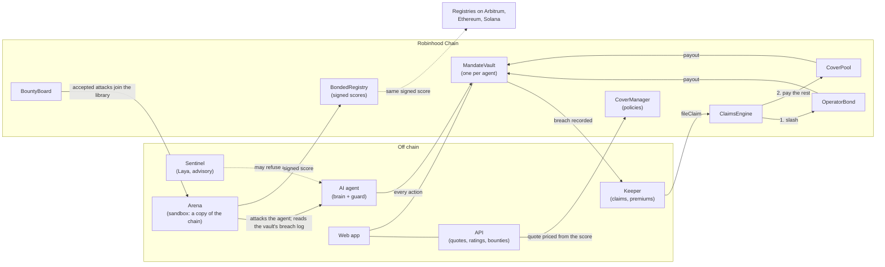

# Architecture

How Bonded's parts fit together. The design reasoning is in `docs/PLAN.md` Sections 5–14 and the decision records in [decisions/](decisions/); this page is the map.

## The picture

The solid arrows that decide money (vault → keeper → claims → bond and pool) are all on chain and deterministic. Every AI component (the agent, the Arena's attackers, Sentinel) sits off chain and can only cause actions that the vault then judges.

## On chain (EVM)

Solidity 0.8.28, Foundry, OpenZeppelin v5. Code: `contracts/evm/src/`; one-paragraph summaries in [contracts/evm/README.md](../contracts/evm/README.md).

| Contract | Role |
|---|---|
| `MandateVault` | An ERC-4626 vault per agent. The agent's key can only act through `execute`, which classifies each call against the mandate (tokens, contracts, destinations, per-trade and daily limits). **Monitor** mode records breaches and lets them through; **Enforce** blocks them. A breach can freeze the agent. The breach log is the single source of truth for ratings and claims (Section 6.3) |
| `MandateVaultFactory` | Creates vaults. Only factory vaults can be insured |
| `BondedRegistry` | Agents (ERC-8004 compatible) and their latest score, signed by an attester (EIP-712) |
| `CoverManager` | Binds cover from an attester-signed quote: checks the score's tier, the bond, and the pool's capacity, per-agent and per-model-family caps; streams premiums from the vault |
| `OperatorBond` | The operator's first-loss stake |
| `CoverPool` | Underwriters' capital (ERC-4626). Withdrawals wait a cooldown and can only use capital not backing active cover |
| `ClaimsEngine` | Pays a claim for breaches the vault recorded: loss minus a 10% deductible, the bond first, then the pool, into the vault |
| `DisputeModule` | Grey-area claims the chain can't see, decided by a council after a challenge window |
| `BountyBoard` | Community attacks: commit, reveal, then an attester accepts and pays or rejects |

Deployed on Robinhood Chain testnet, Arbitrum Sepolia and Ethereum Sepolia; addresses in [contracts/evm/deployments/](../contracts/evm/deployments/README.md).

## On chain (Solana)

Anchor programs for the same core: `bonded_registry`, `bonded_vault`, `bonded_cover` (Section 7, [ADR-011](decisions/011-solana-programs.md)). Deployed on devnet. The keeper files Solana claims too.

## The Arena

`apps/arena`. An episode (Section 8.1):

1. Start a sandbox: a local chain, or a fork of the live chain, with the same contracts.
2. Create a vault with the agent's mandate.
3. Plant one attack from the library (`attacks/`, ten classes) in the agent's world: inbox, news, social posts, prices, token metadata, transaction history, market data, tool output, messages from other agents.
4. Give the agent a benign task and let it act through its tools, which go through the vault.
5. Judge by the vault's breach log, never by what the agent says or an AI grader.

A rating runs every attack (usually five times) plus control episodes with no attack, turns breach rates into an expected loss, premium and score (Section 9; the maths is `packages/shared/src/actuarial.ts`), signs the attestation and posts it. The same code runs a single attack against a real vault for the demo's break-it run (`runLiveAttack`). The agents themselves are in `apps/demo-agents` ([AGENTS.md](AGENTS.md)).

## Off-chain services

One Docker image, three roles on Railway ([SERVICES.md](SERVICES.md), [ADR-008](decisions/008-hosting-and-storage.md)), sharing Postgres:

| Service | Does |
|---|---|
| `api` | REST and server-sent events: signed quotes, rating jobs, scores, reports, the leaderboard, bounty reveals |
| `arena-worker` | Runs rating jobs and validates bounty submissions in a sandbox forked from the live chain, then posts scores and pays bounties with the attester key |
| `keeper` | Watches vaults for breaches and files claims; accrues premiums; checks TEE agents; sends Telegram alerts |

Jobs use a Postgres `FOR UPDATE SKIP LOCKED` queue; every transaction that moves money records its intent and nonce before broadcasting, so a crash can't pay twice.

## Sentinel

`services/sentinel` serves Laya, an open-source decision model, fine-tuned on Arena episodes to answer whether an action was manipulated by planted content ([SENTINEL.md](SENTINEL.md)). An agent can put it in front of its writes as a guard. It is advisory: it can stop an agent from acting, but the vault and the claims contracts never consult it. Version 5 is in production; how it was tested is in [SENTINEL-STRESS.md](SENTINEL-STRESS.md).

## TEE key custody

An agent's key can be generated inside a Phala Cloud confidential VM (Intel TDX). The Arena verifies the VM's quote and puts its measurement in the signed score, and the web app shows a TEE badge. A key held on the operator's server adds expected loss to the score ([ADR-012](decisions/012-tee-custody.md), [ADR-014](decisions/014-key-custody-in-the-score.md), [TEE.md](TEE.md)).

## Web app

`apps/web`, Vite and React on Vercel. It reads the chain directly for everything that matters (scores, vaults, policies, claims) and the API for reports, the live feed, quotes and bounties ([ADR-010](decisions/010-web-app.md)).

## Trust model

| Who | Can | Can't |
|---|---|---|
| Agent key | Act through its vault, within or (in Monitor mode) outside the mandate | Move funds without the vault recording it; touch the bond or pool |
| Guardian (operator) | Freeze, unfreeze and rotate its agent; buy and cancel cover | Change a vault's mandate after creation |
| Attester | Sign scores and quotes; judge bounties | Pay a claim: claims follow the breach log only |
| Owner (one key on testnets) | Set risk parameters and attesters; on testnets, set MockOracle prices, which losses are measured with | Withdraw pool or bond funds |
| Anyone | File a claim for a recorded breach | Get a claim paid for a breach the vault didn't record |

Known gaps and their fixes are in [AUDIT.md](AUDIT.md).
